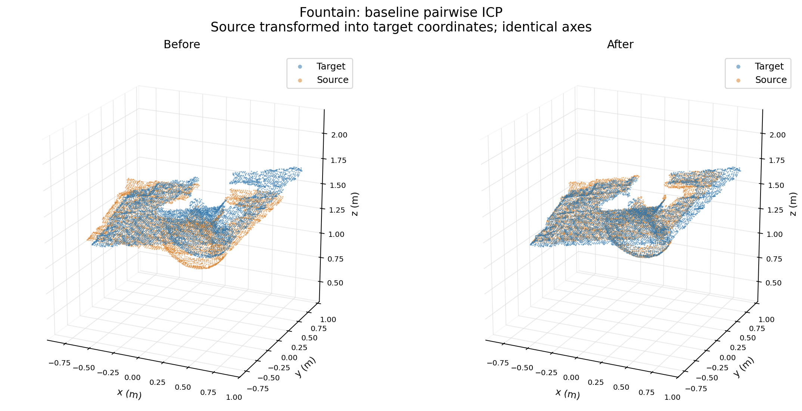

# RGB-D point-cloud processing and registration

An offline 3D perception project that converts RGB-D images into coloured point clouds and aligns two views of a scene. Six public Fountain keyframes are used to study how preprocessing, initialization and image coverage affect registration.

**Python / NumPy / Open3D**

[One-page project note (PDF)](PROJECT_NOTE.pdf) · [Core pipeline](pipeline.py) · [Experiment results](results/metrics.csv) · [Reproduction check](VALIDATION_2026-10-27.txt)



## Recorded result

For keyframes **0 to 1**, starting from the identity transform:

- **Fitness: 0.2528 to 0.9658.** This is the fraction of source points with a target neighbour within 3 cm, not an accuracy score.
- **Matched-point RMSE: 16.76 to 6.37 mm.** This measures matched-neighbour distances, not camera-pose error. Evaluation uses fixed 1 cm voxel clouds and a 3 cm distance threshold.
- **14 experiment records** cover nine preprocessing/ICP configurations, poor initialization, restricted image coverage, empty matches and two additional frame pairs. A poor initial guess reached only **0.0592 fitness**, so failure cases are retained alongside successful-looking alignments.
- **Five unit tests** check projection, coordinate conventions, a known synthetic rigid transform and empty-match handling. All five tests and all 14 experiments were rerun on **27 October 2026**; the recorded evaluation metrics reproduced within numerical tolerance. See the [validation record](VALIDATION_2026-10-27.txt).

The implementation and original experiment records were prepared on **23 October 2026**. The [HTML experiment report](results/report.html) contains the figures and detailed interpretation; download the repository and open that file locally to view the rendered report.

## Explore the project

- **Summary:** [project note](PROJECT_NOTE.pdf), [alignment figure](results/figures/02_alignment.png), [stress-case figure](results/figures/04_stress_cases.png).
- **Implementation:** [geometry and ICP pipeline](pipeline.py), [experiment protocol](run_experiments.py), [tests](tests/test_pipeline.py).
- **Evidence:** [metrics CSV](results/metrics.csv), [transforms and full records](results/experiments.json), [environment and source hashes](results/run_metadata.json).
- **Data:** [six RGB-D keyframe pairs](data/fountain/), [provenance and checksums](data/fountain/manifest.json), [data preparation script](prepare_data.py).

## What is included

- Six unchanged RGB/depth keyframe pairs, source attribution and SHA-256 checksums.
- NumPy pinhole back-projection, including invalid-depth filtering and RGB colors.
- Open3D voxel downsampling, statistical outlier removal and normal estimation.
- Pairwise point-to-plane ICP using Open3D's implementation.
- A 3 by 3 parameter study, poor-initialization and restricted-view tests, and two additional pairs.
- Numeric results, transformations, point-cloud PLY files and static figures.
- Five checks for geometry, coordinate conventions, empty correspondences and a known synthetic rigid transform.

This is offline processing of public recordings. It does not demonstrate collecting data with a camera, calibrating sensors, training a neural network, running on Jetson or controlling a manipulator.

## Run

Python 3.12, Windows 64-bit was used for the recorded run. Use a **short project path**, for example `D:\rgbd-project`, when making a new environment; long Windows paths can break installation of transitive Open3D dependencies.

```powershell
py -3.12 -m venv .venv
.\.venv\Scripts\python.exe -m pip install -r requirements.txt
.\.venv\Scripts\python.exe -m unittest discover -s tests -v
.\.venv\Scripts\python.exe run_experiments.py --output results_local
```

Open `results_local/report.html` after the run. Using a separate output directory preserves the original records in `results/`. The six sample pairs are included, so the experiment itself works offline. To download them again from Open3D's official distribution:

```powershell
.\.venv\Scripts\python.exe prepare_data.py
```

One-pair practice run (writes separately from the recorded result):

```powershell
.\.venv\Scripts\python.exe run_experiments.py --mode single --voxel 0.04 --output results_practice
```

Change views with `--source 4 --target 5` in single mode. A full run uses the fixed protocol: pair 0 to 1, voxel sizes 0.01/0.02/0.04 m, ICP thresholds 0.02/0.05/0.10 m. For exact dependency versions on the recorded Windows environment, use `environment-lock.txt`. Runtime changes across machines are expected; timings here are not a benchmark.

## Files to read in order

1. [pipeline.py](pipeline.py): back-projection, preprocessing, ICP call and evaluation.
2. [run_experiments.py](run_experiments.py): the comparison protocol and result export.
3. [figures.py](figures.py): plotting only; these functions do not change the experiment.
4. [tests/test_pipeline.py](tests/test_pipeline.py): independent checks using small known examples.

[prepare_data.py](prepare_data.py) obtains the public sample and records its provenance. [results/experiments.json](results/experiments.json) contains all 4x4 transforms; [results/metrics.csv](results/metrics.csv) contains the scalar measurements. [results/run_metadata.json](results/run_metadata.json) records the environment, timestamp, source hashes and data hash. The recorded run used at most four OpenMP threads.

## Coordinate and evaluation choices

- Camera x points right, y down and z forward; all 3D distances are metres.
- `z = d / 1000`, `x = (u - cx) * z / fx`, `y = (v - cy) * z / fy`.
- The documented PrimeSense pinhole values are used: fx=fy=525, cx=319.5, cy=239.5, 640x480. No new calibration is claimed.
- A returned ICP matrix maps source-camera points into target-camera coordinates.
- Optimizer parameters vary, but every sweep result is evaluated using the same 1 cm evaluation clouds and 3 cm distance threshold.
- Normal-estimation radius is three times the optimizer voxel size, so this compares preprocessing configurations rather than isolating voxel size as the only changing variable.
- Fitness uses the source point count as its denominator. Reverse fitness is also reported because visible coverage is asymmetric.
- Inlier RMSE only measures matched neighbours. It is not the point-to-plane loss or a pose accuracy score. An empty match set has no meaningful RMSE; it is stored as null.
- The author-supplied trajectory is estimated, not independent ground truth. Its relative pose is never used to initialize ICP. Differences against it are diagnostics, not absolute accuracy.
- Cropped images are masked without moving the original pixel coordinates. Pixel crop percentages are not measured 3D overlap percentages.

## Data and software credit

Fountain: Qian-Yi Zhou and Vladlen Koltun, **Color Map Optimization for 3D Reconstruction with Consumer Depth Cameras**, ACM Transactions on Graphics (SIGGRAPH), 2014. The [author's data page](https://www.qianyi.info/scenedata.html) describes the Asus Xtion Pro Live recordings, projection parameters and permission to use the data with attribution. Original images are unmodified; only filenames are shortened locally, with original names preserved in the manifest.

The subset is obtained through [Open3D SampleFountainRGBDImages](https://www.open3d.org/docs/release/python_api/open3d.data.SampleFountainRGBDImages.html). The bundled `key.log` contains the original 33 reference poses; the manifest selects the first six in the same order. Open3D imports the log by inverting its camera-to-world transforms.

Open3D: Qian-Yi Zhou, Jaesik Park and Vladlen Koltun, **Open3D: A Modern Library for 3D Data Processing**, 2018. See the [ICP tutorial](https://www.open3d.org/docs/release/tutorial/pipelines/icp_registration.html) and [RGB-D tutorial](https://www.open3d.org/docs/release/tutorial/geometry/rgbd_image.html). This project calls the library's ICP solver; it does not claim to implement a new registration algorithm.
